---

### 🛡️ Proyectos Destacados
* 🤖 **[FuzzingLocalBot](https://github.com/Enric-xX/FuzzingLocalBot)** - Herramienta de fuzzing local.
* 🏢 **[Server-1](https://github.com/Enric-xX/Server-1)** - Servidor vulnerable para practicar hacking.
* 🏢 **[Server-2](https://github.com/Enric-xX/Server-2)** - Servidor vulnerable para practicar hacking.
* 🏢 **[Server-3](https://github.com/Enric-xX/Server-3)** - Servidor vulnerable para practicar hacking.
* 🔍 **[Python Tools](https://github.com/Enric-xX/PythonTools)** - Herramientas de ciberseguridad en python.
* 🚀 **[CoreAI](https://github.com/Enric-xX/PythonTools)** - Optimizador de Windows.
---

### 🎮 Sobre mí
* 🔫 Jugador de **CS2**.
* 🇪🇸 Hablo Español.
* 🎯 Enfocado en ciberseguridad y bug bounty.
* 🤖 Uso IA para crear herramientas útiles.
* 🎓 Perfil de TryHackMe: [3nric](https://tryhackme.com/p/3nric)

---

> [!NOTE]  
>¡Gracias por pasarte por mi perfil!
